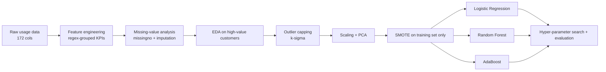

# 📡 Telecom Customer Churn Prediction


> Predicting which **customers are about to leave** a telecom operator — using 3 months of usage behaviour, PCA, SMOTE and three ML pipelines.

| | Logistic Regression | **Random Forest** | AdaBoost |
|---|---|---|---|
| Test accuracy | 0.850 | **0.919** | 0.839 |
| Precision (churn) | 0.389 | **0.592** | 0.368 |
| **Recall (churn)** | **0.835** | 0.651 | 0.820 |
| F1 (churn) | 0.531 | **0.620** | 0.508 |
| ROC-AUC | 0.906 | **0.907** | 0.904 |

*Evaluated on a held-out 20% split (14,000 customers, ~10% churners).*

---

## 📌 Business Problem

In the telecom industry customers switch operators easily, leading to **15–25% annual churn**. Acquiring a new customer costs **5–10× more** than retaining one, so operators want to:

1. **Predict** which customers are likely to churn, early enough to act.
2. **Understand** which usage signals indicate churn, so retention offers can be targeted.

## 🗂️ Data

| File | Rows | Description |
|---|---|---|
| `train.csv` | 69,999 | 172 columns: recharge, ARPU, call minutes (local/STD/ISD/roaming, on-net/off-net), data usage, 2G/3G packs for June–August, plus `churn_probability` label |
| `test.csv` | 30,000 | Same features without the label (used for the final submission) |
| `data_dictionary.csv` | — | Acronym glossary (ARPU, MOU, T2T, ONNET, VBC…) |

## 🔬 Approach



- **Feature engineering** – grouped raw columns by meaning (recharge amounts, ARPU, outgoing/incoming minutes, roaming, special calls, ISD, data packs, social-media scheme users) to create interpretable aggregates.
- **Missing values** – visualised with `missingno`, then imputed per feature group.
- **Outliers** – capped with the k-sigma method instead of dropping rows.
- **Dimensionality reduction** – PCA to compress highly correlated usage features.
- **Class imbalance (~10% churn)** – SMOTE applied **only to the training data** to avoid leakage.
- **Models** – three reusable `sklearn` pipelines, tuned with `GridSearchCV` / `RandomizedSearchCV`.

## 📈 Results & Model Choice

The "best" model depends on the business cost of each error:

- **Random Forest** gives the best overall balance (**accuracy 0.92, F1 0.62**) — use it when retention offers are expensive and false alarms must be limited. It fits the training data almost perfectly, so its train–test gap is the largest.
- **Logistic Regression / AdaBoost** catch **~83% of churners** (highest recall) at the cost of more false positives — use them when *missing* a churner is far more costly than sending an unnecessary offer.

All three reach **ROC-AUC ≈ 0.90**, showing the engineered features separate churners well. The final Kaggle-style submission (`Results_19Jan.csv`) was generated with the AdaBoost pipeline.

## 💡 What I Learned

- Accuracy is misleading on imbalanced data — **precision, recall and ROC-AUC** tell the real story.
- Model selection is a **business decision**: the precision–recall trade-off maps directly to campaign cost.
- Applying SMOTE, scaling and PCA **inside the training fold only** is essential to avoid leakage.

## 🚀 How to Run

```bash
git clone https://github.com/AnishRane-cox/Telecom-Churn-Case-Study.git
cd Telecom-Churn-Case-Study
pip install pandas numpy matplotlib seaborn missingno scikit-learn imbalanced-learn jupyter
jupyter notebook telecom-churn_casestudy.ipynb
```

## 📁 Repository Structure

```
├── telecom-churn_casestudy.ipynb   # End-to-end analysis & modelling
├── train.csv / test.csv            # Data
├── data_dictionary.csv             # Column glossary
├── Results_19Jan.csv               # Predictions on the unseen test set
└── README.md
```

## 🔭 Next Steps

- Tune the **decision threshold** on the Random Forest to trade some precision for recall.
- Try gradient boosting (XGBoost / LightGBM) and SHAP for feature-level explanations.
- Build a churn-risk score that combines probability with customer value (ARPU).

---

## 👤 Author

**Anish Rane** — Data & AI Engineer · MSc Machine Learning & AI (LJMU) · Mechanical Engineer

[](https://anishrane-cox.github.io/Portfolio/)
[](https://www.linkedin.com/in/anish-rane/)
[](https://github.com/AnishRane-cox)

⭐ If you found this useful, consider starring the repo.
